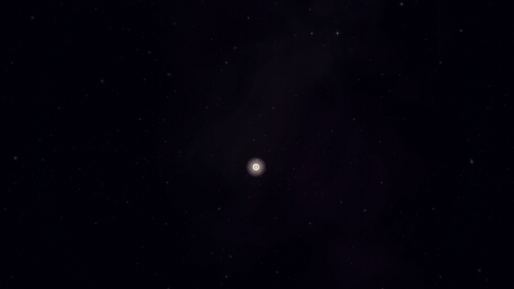
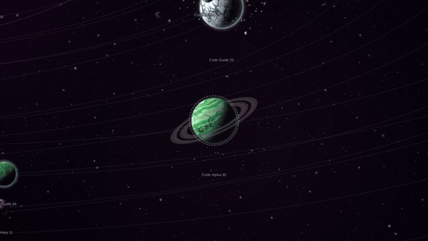
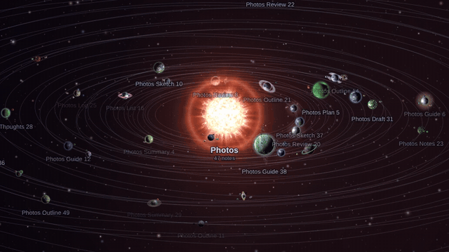
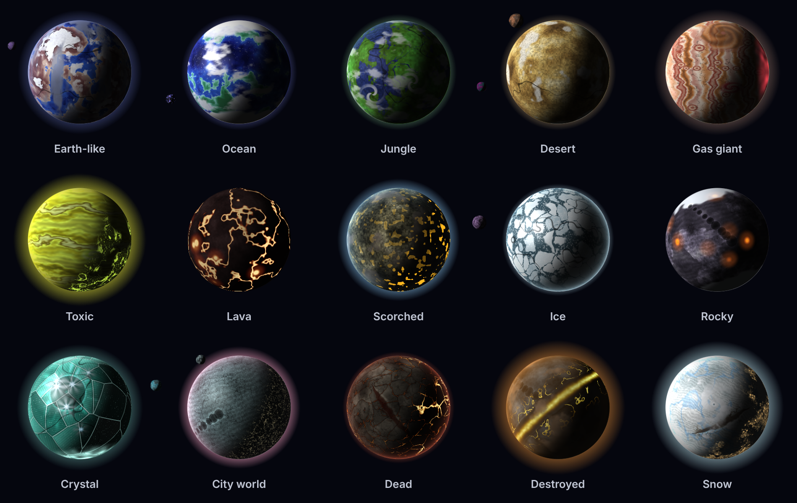
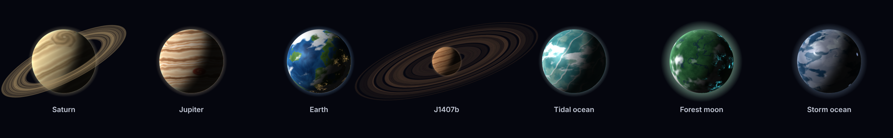

<h1 align="center">Planetarium</h1>

<p align="center">An Obsidian plugin that turns your vault into a universe.<br>Folders are suns. Notes are planets.</p>

<p align="center">
  <a href="https://unscathering.github.io/Planetarium/"><b>Try the live demo</b></a> ·
  <a href="#install">Install</a> ·
  <a href="#how-the-planets-are-made">How the planets are made</a>
</p>

<p align="center">
  
</p>

## Contents

- [What it does](#what-it-does)
- [See it move](#see-it-move)
- [The planets](#the-planets)
- [How the planets are made](#how-the-planets-are-made)
- [Install](#install)
- [Controls](#controls)
- [Settings](#settings)
- [Building from source](#building-from-source)
- [License](#license)

## What it does

- Every top-level folder becomes a star, bigger the more notes it holds. About one folder in twelve gets a black hole instead.
- Every note becomes a planet in orbit around its folder's star. The same note always gets the same planet.
- Folders that link to each other a lot drift closer together, with glowing lanes between them.
- Hover a planet to peek at the note, and click it to open it.
- Search for a note and the camera flies there. You can also filter by tag or folder, or replay your vault's history and watch the planets appear in the order you wrote them.
- Make a note while the view is open and it pops into orbit.

## See it move

<p align="center">
  
</p>

Hover any planet for a card with the start of the note, its tags, and how rare its planet is.

<p align="center">
  
</p>

<!-- Videos: drag flyin.mp4 and the other clips onto this spot in GitHub's editor. -->

## The planets

Fifteen kinds of world, each with its own patterns, colours, weather, rings and moons:

<p align="center">
  
</p>

Every so often a note lands on something rarer. It might be a real planet from our solar system, or J1407b with its enormous rings, or one of a handful of worlds inspired by science fiction:

<p align="center">
  
</p>

## How the planets are made

Nothing is stored. Each planet is worked out from the note's path, which gets turned into a number. That number seeds a random roll, so the same note gives the same planet every time, and it only changes if you rename or move the note.

The roll works through a list of traits:

- what kind of world it is
- its surface pattern, colours and fine detail
- clouds and how stormy they get
- atmosphere, rings and moons
- size and tilt
- maybe a special feature, like city lights or a giant rift

Each kind of world has its own options, so a gas giant won't roll a coastline. Multiply all of it out and you get roughly 1.1 quadrillion possible planets.

The surfaces are painted from layered noise, the same trick games use for terrain, in a background thread. Each one is painted once and then reused, so moving around stays smooth. The light always comes from the planet's own sun, so you see day and night sides, and city lights only come on in the dark.

The rarity on each card is just the odds of that exact roll. Even the most ordinary planet is about 1 in a few million. Legendary means 1 in a quadrillion or longer.

Suns work the same way, using the folder's name: 1,000 kinds of star and 216 kinds of black hole.

## Install

Until it's listed in Obsidian's Community plugins:

1. Download `main.js`, `manifest.json` and `styles.css` from the [latest release](https://github.com/Unscathering/Planetarium/releases/latest).
2. In your vault, create the folder `.obsidian/plugins/planetarium/` and put the three files in it. The `.obsidian` folder is hidden; press `Cmd+Shift+.` in the macOS Finder, or choose View > Show > Hidden items on Windows.
3. In Obsidian, open Settings > Community plugins and turn on **Planetarium**. You might need to click refresh first.
4. Click the sun icon in the left sidebar.

It isn't desktop-only, so it should run on mobile too.

## Controls

| Do this | To |
| --- | --- |
| Drag, scroll, pinch | Move and zoom |
| Click a planet | Open the note (Ctrl/Cmd-click for a new tab) |
| Click a sun | What kind of star it is |
| Double-click a sun | Fly into its system |
| `/` | Search |
| `H` | Show the whole universe |
| `L` | Fly to the note you have open |
| `Tab` | Next system |
| `Space` | Pause the orbits |
| `?` | The legend: what every colour and glow means |

## Settings

Under Settings > Planetarium you can change orbit speed and the size of planets and suns. You can pick a nebula style, or let it surprise you. You can switch the background stars, link lanes, trails, labels, rogue planets (notes with no links) and moons (notes that link to just one other note) on or off. If the view feels heavy on an older machine, set Performance to Balanced or Battery saver.

## Building from source

You need [Node.js](https://nodejs.org) 18 or newer.

```bash
npm install
npm run build          # type-checks and builds main.js
npm run dev            # rebuilds while you edit
node demo/build.mjs    # builds the web demo into demo/dist/index.html
```

The planet generators live in `src/planets/`. `preview/` has pages for checking them by eye.

## License

[MIT](LICENSE)
